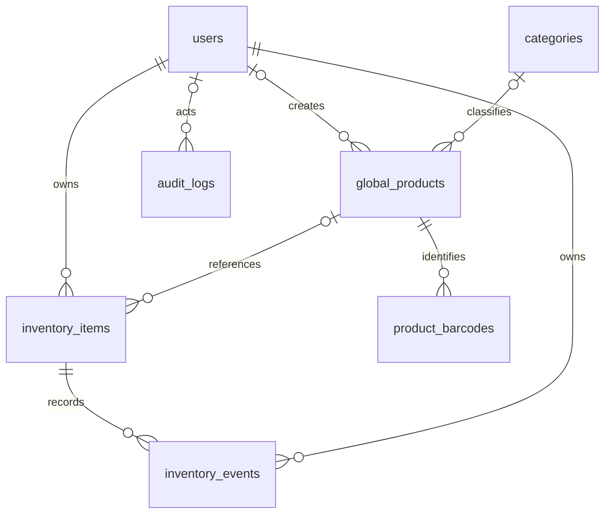

# ShelfLife Database V2

## Why global_products exists

`global_products` is the shared catalog: a product name, category and barcode identify
what a product is. `inventory_items` describes a particular user's batch: quantity,
expiry date and whether it was consumed or discarded. Two purchases of the same milk
can therefore share a product but have different expiry dates. A manually entered
item can have no catalog match. Its name and barcode are still preserved.

อธิบายให้อาจารย์: สินค้ากลางคือข้อมูลว่า “สินค้านี้คืออะไร” ส่วนคลังส่วนตัวคือ
“ใครมีสินค้านี้ จำนวนเท่าไร และล็อตนี้หมดอายุเมื่อไร” วันหมดอายุจึงอยู่ที่คลัง
ไม่ใช่สินค้ากลาง การเปลี่ยนชื่อสินค้ากลางไม่เปลี่ยนชื่อที่บันทึกไว้ในคลังย้อนหลัง

## Data dictionary

All existing IDs and columns remain. New foreign-key integers use the same signed
INT type as V1. All new tables use InnoDB and utf8mb4_unicode_ci.

| Table | Columns and purpose |
|---|---|
| users | `user_id` INT PK; `username` VARCHAR(50) unique; `email` VARCHAR(254) nullable unique (legacy accounts stay NULL); `password_hash` VARCHAR(255), Argon2 encoded; `role` ENUM(user,admin); `is_active` BOOLEAN; `created_at`, `updated_at` TIMESTAMP |
| categories | `category_id` INT PK; `category_name` VARCHAR(50) unique; `is_active` BOOLEAN |
| global_products | `product_id` INT PK; `barcode` VARCHAR(50) unique, primary barcode retained for V1 compatibility; `product_name` VARCHAR(100); `category` VARCHAR(50), retained; `category_id` nullable FK; `created_by` nullable users FK; `is_active` BOOLEAN; `created_at`, `updated_at` TIMESTAMP |
| product_barcodes | `barcode_id` INT PK; `product_id` required FK; `barcode` VARCHAR(50) unique; `is_primary` BOOLEAN. Changing the primary barcode retains the previous barcode as an alias. There is no independent alias-edit endpoint yet. |
| inventory_items | `item_id` INT PK; `user_id` required FK; `barcode` nullable VARCHAR(50); `product_name` VARCHAR(100), legacy field; `category` VARCHAR(50); `quantity` INT; `expiration_date` DATE; `status` ENUM(active,consumed,discarded); `status_updated_at` nullable TIMESTAMP; `created_at`, `updated_at` TIMESTAMP; `product_id` nullable FK; `product_name_snapshot` nullable VARCHAR(100), backfilled; `deleted_at` nullable TIMESTAMP |
| inventory_events | `event_id` BIGINT PK; `item_id`, `user_id` required FKs; `event_type` VARCHAR(20): added/adjusted/active/consumed/discarded/deleted; `quantity_change` signed INT; `occurred_at` TIMESTAMP |
| audit_logs | `log_id` BIGINT PK; `actor_user_id` nullable FK; `action` VARCHAR(50): create/update/delete; `entity_type` VARCHAR(50): product/user; `entity_id` INT; `created_at` TIMESTAMP. No passwords, tokens or request payloads are recorded. |
| schema_migrations | `version` VARCHAR(50) PK; `applied_at` TIMESTAMP. Operational bookkeeping, not a business entity. |

Quantity changes record the difference in **active stock**. Consuming two units
records -2, reactivating the batch records +2. Events and the item mutation commit
in one transaction with a row lock. Deleting is a soft deletion, preserves the batch
and events, and subtracts remaining active stock. Expired is computed from DATE,
not stored as a fourth status. The current UI edits whole batches; partial use can
be represented by reducing quantity but is recorded as an adjustment.

The catalog API writes the legacy category/primary-barcode fields and normalized
tables together. Inventory resolves product links from the barcode on the server;
clients cannot assign ownership or product IDs. User edits to a batch update its
name snapshot; catalog edits do not. API validation rejects non-positive quantities,
impossible dates and overlong values; existing legacy rows are not silently repaired.

Existing indexes remain. V2 adds `(user_id,status,deleted_at,expiration_date)` for
inventory and `(occurred_at,event_type)` for events. Existing user→inventory cascade
is retained for schema compatibility, but the API deactivates users and never
hard-deletes them. Do not manually delete accounts with history.

## Safe migration runbook

1. Back up the database using your normal backup process and verify restoring the
   backup into a separate database. Keep backups outside the repository.
2. Stop writes from old application versions. Rehearse this upgrade against the
   restored copy first, using its own `.env` configuration.
3. From `shelflife-backend`, run `npm ci` and `npm run migrate`. The migrator uses
   the database selected in `.env`. It does not create or replace the database.
4. Verify counts of all three old tables, legacy column values and IDs against the
   backup. Check category links, barcode aliases and snapshot values. Existing
   inventory `updated_at` values are explicitly preserved during backfill.
5. Start the new API, check `/health`, then test registration, login, owner-only
   CRUD and admin screens. Release the matching Flutter client.

`database/migrate.js` contains the SQL and checks information_schema before each
additive DDL operation. A database-scoped advisory lock prevents simultaneous runs.
The version marker is written only after successful backfill. Successful reruns are
no-ops. Interrupted DDL can be resumed after investigating the error. MySQL/MariaDB
DDL auto-commits: this is **not** an all-or-nothing schema transaction. If an existing
column/table has a conflicting definition, inspect it; do not force the migration.

No table/column is dropped, no accounts are renumbered, no password hashes are
rewritten, and no historical events are invented. Legacy placeholder hashes such
as those in the sample dump intentionally cannot log in. Create a real account
through registration and have the database operator explicitly grant the first
administrator role to that verified account. Do not introduce default passwords.

The original SQL dump is for a new, disposable demonstration database only. Never
import it over a team database. Migration tests import it only into a randomly named
`shelflife_test_*` database and remove that database after the test.

Rollback: keep the V2 schema and fix forward where possible. Restoring a backup is
an operator decision because it discards writes made after the backup. Reverting
to the old API is not safe: it lacks ownership checks and ignores soft deletion and
event logging. Additive schema compatibility does not make the old API secure.
