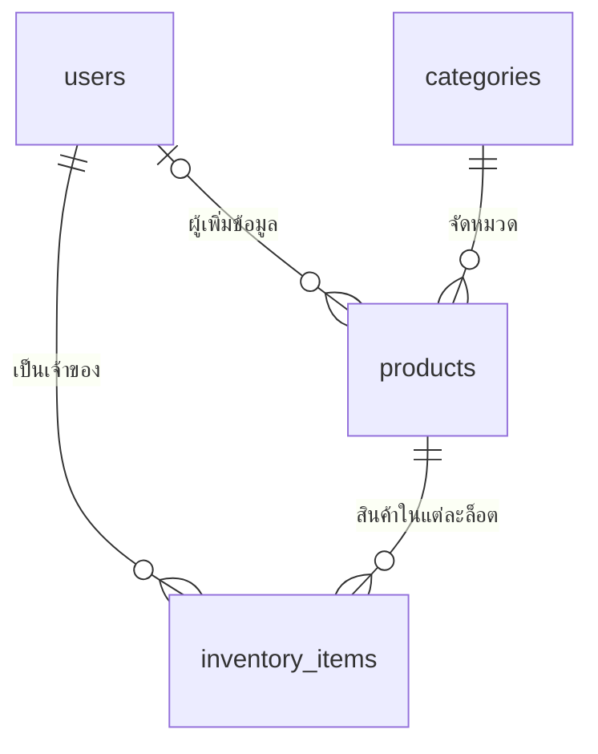

# ShelfLife: ฐานข้อมูลแบบเรียบง่าย (ต้นแบบแยกจากแอปเดิม)

**API ใช้ฐานข้อมูลนี้แล้ว** (ชื่อ `shelflife_v2_db`) โดย API ยังส่ง JSON หน้าตาเดิม
(`barcode`, `product_name`, `category`) จึงไม่ต้องแก้ Flutter วิธีติดตั้งดูที่
`shelflife-backend/README.md` หัวข้อ "ติดตั้งฐานข้อมูล" ฐานข้อมูลเก่า `shelflife_db` ไม่ถูกแก้

## เหลือ 4 ตาราง แต่ละตารางมีหน้าที่เดียว

| ตาราง | หน้าที่ | ตัวอย่าง |
|---|---|---|
| `users` | บัญชีผู้ใช้ | ใครเป็นเจ้าของของในคลัง |
| `categories` | รายชื่อหมวดหมู่ที่ใช้ร่วมกัน | Food, Medicine |
| `products` | สินค้านี้คืออะไร | บาร์โค้ด, ชื่อนม, หมวด Food |
| `inventory_items` | ใครมีสินค้าอะไร อยู่ล็อตไหน | ผู้ใช้ 1 มีนม 2 กล่อง หมดอายุ 20 พ.ย. |

เปลี่ยนชื่อ `global_products` เป็น `products` ใน **ฐานข้อมูลใหม่** เพื่อให้เรียกง่ายขึ้น
ตารางนี้เป็นรายการสินค้าอ้างอิง ไม่ใช่คลังรวมของผู้ใช้ทุกคน และไม่ใช่รายการซื้อ



## ข้อมูลซ้ำที่เอาออก

เดิม `inventory_items` เก็บทั้ง `barcode`, `product_name`, `category` ซ้ำกับ
`global_products` เมื่อชื่อสินค้าถูกแก้จึงมีโอกาสแสดงไม่ตรงกัน

แบบใหม่ `inventory_items` เก็บ `product_id` เพื่ออ้างอิงสินค้า โดยไม่เก็บชื่อ
บาร์โค้ด หรือหมวดหมู่ซ้ำอีก และ `products` ใช้ `category_id` แทนข้อความหมวดหมู่
ซ้ำหลายแถว **ไม่มีการเพิ่มตารางบาร์โค้ด ประวัติสินค้า หรือ audit log**

ตัวอย่าง: ซื้อสินค้าชนิดเดียวกันสองครั้ง แต่หมดอายุคนละวัน จะมีสินค้า 1 แถว
และคลัง 2 แถว นี่เป็นคนละล็อต ไม่ใช่ข้อมูลซ้ำที่ควรลบ สคริปต์ไม่รวมจำนวนหรือ
รวมล็อตให้เอง แม้ชื่อและวันหมดอายุจะตรงกัน

ชื่อสินค้าจะแสดงจาก `products` เสมอ หากเปลี่ยนชื่อสินค้าภายหลัง ชื่อที่แสดงใน
ทุกล็อตจะเปลี่ยนตาม นี่เป็นการเลือกให้มีชื่อหลักเดียว; ไม่มีระบบเก็บชื่อย้อนหลัง
หากภายหลังต้องการประวัติชื่อ ค่อยพิจารณาเพิ่มตามความต้องการจริง

## คอลัมน์ที่มีและเหตุผล

| ตาราง | คอลัมน์ |
|---|---|
| users | `user_id` INT PK, `username` VARCHAR(50) UNIQUE, `email` VARCHAR(254) NULL UNIQUE, `password_hash` VARCHAR(255), `role` ENUM(user,admin), `created_at`/`updated_at` TIMESTAMP |
| categories | `category_id` INT PK, `category_name` VARCHAR(50) UNIQUE |
| products | `product_id` INT PK, `barcode` VARCHAR(50) NULL UNIQUE, `product_name` VARCHAR(100), `category_id` FK, `created_by` NULL FK, `created_at` TIMESTAMP, `unbarcoded_name` (อัตโนมัติ) |
| inventory_items | `item_id` INT PK, `user_id` FK, `product_id` FK, `quantity` INT CHECK > 0, `expiration_date` DATE, `status` ENUM(active,consumed,discarded), `status_updated_at` NULL TIMESTAMP, `created_at`/`updated_at` TIMESTAMP |

- `email` เป็น NULL สำหรับบัญชีเดิม ไม่สร้างอีเมลปลอมหรือแก้รหัสผ่าน
- สินค้าไม่มีบาร์โค้ดได้ โดยใช้ `product_id` เป็นตัวอ้างอิง
- สินค้าที่**มี**บาร์โค้ดต่างกันใช้ชื่อซ้ำกันได้ เพราะคนละยี่ห้ออาจชื่อเหมือนกัน แต่สินค้าที่
  **ไม่มี**บาร์โค้ดห้ามชื่อซ้ำในหมวดเดียวกัน กันด้วยคอลัมน์อัตโนมัติ `unbarcoded_name`
  (ค่าเท่ากับชื่อเมื่อไม่มีบาร์โค้ด, NULL เมื่อมี) + `UNIQUE (unbarcoded_name, category_id)`
  ไม่ต้องใส่ค่าคอลัมน์นี้เอง
- ถ้าสินค้าจากคลังไม่มีในรายการสินค้ากลาง จะสร้างข้อมูลสินค้าในฐานข้อมูลใหม่ให้
- หมวดหมู่จะสร้างจากข้อมูลจริง ไม่สร้างรายการตัวอย่างเพิ่มเติม
- ลบผู้ใช้ได้ (`ON DELETE CASCADE`): ล็อตในคลังของผู้ใช้คนนั้นจะถูกลบตาม (เหมือน V1
  และรองรับ API ลบผู้ใช้) ส่วนสินค้าที่เขาเคยเพิ่มยังอยู่ โดย `created_by` เป็น NULL
- ลบสินค้าที่ยังมีล็อตในคลังอ้างอิงไม่ได้ (`RESTRICT`) เพื่อไม่ให้คลังของคนอื่นหายตาม
- ล็อตที่สถานะเป็น `consumed`/`discarded` ต้องมี `status_updated_at` เสมอ
  (`chk_inventory_status_time`) ส่วน `active` จะมีหรือไม่มีก็ได้ เผื่อกรณีเปลี่ยนกลับเป็น active
- วันหมดอายุอยู่ที่ล็อตในคลังเท่านั้น “หมดอายุแล้ว” คำนวณจากวันที่ ไม่เก็บเป็นสถานะซ้ำ
- Index `(user_id,status,expiration_date)` รองรับการค้นคลังตามเจ้าของและวันหมดอายุ

## ไฟล์ที่ใช้

- `schema.sql` — โครงสร้างใหม่ครบ 4 ตาราง สำหรับฐานข้อมูลว่างเท่านั้น
- `copy-to-test.js` — ตรวจ V1 และคัดลอกไปฐานข้อมูลทดสอบใหม่ โดยไม่เขียนต้นทาง
- `database.test.js` — ทดสอบความสัมพันธ์ การกันข้อมูลผิด และการรักษาต้นทาง
- `example-queries.sql` — ตัวอย่าง JOIN เพื่ออ่านชื่อสินค้าโดยไม่เก็บข้อมูลซ้ำ

## วิธีตรวจและทดลองคัดลอก (ยังไม่เปลี่ยนแอป)

ต้องมี Node.js และ MySQL 8.4 หรือ MariaDB 10.11 ขึ้นไป ใช้ `mysql2` ที่โปรเจกต์มีอยู่แล้ว
ให้ผู้ดูแลสำรองข้อมูลและซ้อมจากฐานข้อมูลสำเนา เช่น `shelflife_source_copy` ก่อน
สคริปต์ไม่โหลด `.env` ของแอปและไม่มีสิทธิ์เปลี่ยนการเชื่อมต่อของแอปให้เอง

จากโฟลเดอร์ `shelflife-backend` ใน PowerShell ตั้งค่าผ่าน environment ของเครื่อง:

```powershell
$env:MIGRATION_DB_HOST = '127.0.0.1'
$env:MIGRATION_DB_PORT = '3306'
$env:MIGRATION_DB_USER = 'ชื่อบัญชีสำหรับการทดสอบ'
# ตั้ง MIGRATION_DB_PASSWORD ผ่านระบบจัดการ secrets ของเครื่อง ห้ามบันทึกใน Git

node database/simple-v2/copy-to-test.js --source shelflife_source_copy --report ../review-labels.json
```

คำสั่งนี้ตรวจอย่างเดียว ไม่สร้างฐานข้อมูล ถ้าพบชื่อ/หมวดหมู่ที่ไม่ตรงกันจะอยู่ใน
`catalog_label_conflicts` ถ้าพบข้อมูลผิดจะอยู่ใน `errors` รายงานไม่มีรหัสผ่านหรือ
ข้อมูลบัญชี แต่มีข้อมูลสินค้า จึงให้เก็บนอก Git และตั้งชื่อไฟล์ใหม่ทุกครั้ง

เมื่อรายงานไม่มีปัญหา:

```powershell
node database/simple-v2/copy-to-test.js --source shelflife_source_copy --copy --target shelflife_v2_review
```

**กรณีชื่อไม่ตรงกัน**: ข้อมูลตัวอย่างเดิมมี `Fresh Milk` ในคลัง แต่มี `Fresh Milk 1L`
ในรายการสินค้า สคริปต์จะไม่เดาว่าควรใช้ชื่อใด ถ้าตรวจแล้วต้องการให้ฐานข้อมูลใหม่
ใช้ชื่อและหมวดหมู่จากสินค้ากลาง ให้ยอมรับอย่างชัดเจนและสร้างรายงานอีกไฟล์:

```powershell
node database/simple-v2/copy-to-test.js --source shelflife_source_copy --copy --target shelflife_v2_review --accept-catalog-labels --report ../accepted-labels.json
```

ชื่อต้นฉบับยังอยู่ในฐานข้อมูลต้นทางและรายงาน ไม่มีการเขียนทับต้นทาง ถ้ารายการ
คลังใช้บาร์โค้ดเดียวกันแต่ชื่อไม่ตรงกันและไม่มีสินค้ากลางเป็นข้อมูลอ้างอิง สคริปต์
จะไม่ยอมรับด้วย flag นี้ ต้องตรวจและแก้เฉพาะฐานข้อมูลสำเนาก่อน

สคริปต์คง ID ผู้ใช้/ล็อต/สินค้ากลางเดิม จำนวน วันหมดอายุ สถานะ เวลา และ password hash
เพิ่มเฉพาะ ID สินค้าที่เดิมยังไม่มีรายการอ้างอิง ไม่มีการรวมล็อต หากไม่มีบาร์โค้ด
รายการที่ชื่อและหมวดตรงกันทุกตัวอักษรจะใช้สินค้าเดียวกัน แต่ยังแยกล็อตตามเดิม
หากเป็นคนละสินค้าที่ชื่อ/หมวดเหมือนกัน ให้แยกข้อมูลบนสำเนาก่อนคัดลอก

## ขอบเขตความปลอดภัยและข้อจำกัด

- รองรับโครงสร้าง V1 ใน `shelflife_db.sql`; ถ้าคอลัมน์เปลี่ยนไป สคริปต์จะหยุดเพื่อให้ตรวจ
- ต้นทางใช้ read-only transaction และ consistent snapshot; ต้องเป็น InnoDB
- ปลายทางต้องชื่อขึ้นต้น `shelflife_v2_` และยังไม่มีอยู่ ห้ามชื่อเดียวกับต้นทาง
- รันซ้ำชื่อปลายทางเดิมจะหยุด ไม่ลบ ไม่เขียนทับ ไม่เติมข้อมูลซ้ำ ให้เลือกชื่อทดสอบใหม่
- DDL สร้างตาราง auto-commit; ถ้าคัดลอกแถวล้มเหลว transaction จะยกเลิกแถวทั้งหมด
  แต่ฐานข้อมูลปลายทางว่างอาจเหลืออยู่ให้ตรวจ สคริปต์ไม่ DROP ฐานข้อมูลเอง
- การเปรียบเทียบชื่อ/บาร์โค้ดของ SQL ขึ้นกับ collation หากพบรูปแบบที่ชนกัน
  สคริปต์จะหยุดและไม่แก้ต้นทาง ไม่รวมชื่อที่สะกดต่างกันให้เงียบ ๆ
- โหลดข้อมูลไว้ในหน่วยความจำ เหมาะกับฐานข้อมูลขนาดโปรเจกต์นี้ ไม่ใช่เครื่องมือย้ายข้อมูลขนาดใหญ่
- API อ่านชื่อสินค้า/หมวดผ่าน JOIN (`utils/catalog.js`) และเพิ่มของเข้าคลังโดยหา/สร้าง
  สินค้าใน `products` ให้อัตโนมัติ ถ้าบาร์โค้ดมีอยู่แล้วจะใช้ชื่อจาก `products` เป็นหลัก
- `shelflife_v2_db.sql` (ไฟล์ติดตั้ง) ต้องมี `schema.sql` อยู่ข้างในแบบไม่แก้ เทสต์จะเตือนถ้าไม่ตรงกัน

## ทดสอบ

```powershell
node --test database/simple-v2/database.test.js
```

ถ้าไม่กำหนด `TEST_DB_HOST` จะรันเฉพาะ unit test และแจ้งว่า integration ข้ามไป
ถ้าต้องการทดสอบฐานข้อมูลจริง ให้กำหนด `TEST_DB_HOST`, `TEST_DB_PORT`, `TEST_DB_USER`,
`TEST_DB_PASSWORD` ของเซิร์ฟเวอร์ทดสอบแยก บัญชีทดสอบต้องสร้าง/ลบฐานข้อมูลได้
ตัวทดสอบใช้ชื่อสุ่มและลบได้เฉพาะฐานข้อมูลที่มันสร้างเอง ไม่ใช้ `.env` ของแอป
